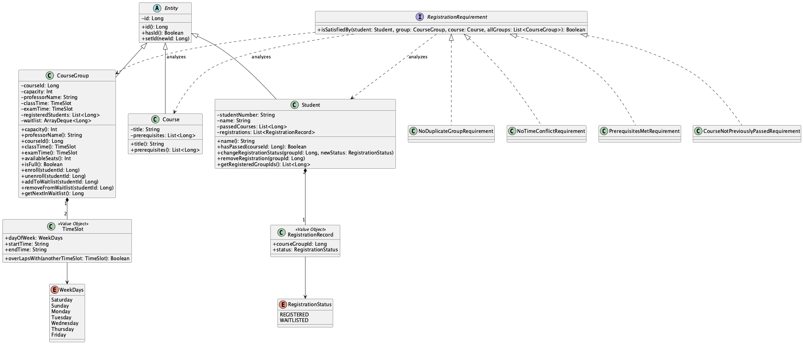

# Systems Analysis and Design

A **course-registration system** developed through requirements analysis, domain modeling, and a Kotlin implementation for the **Systems Analysis and Design** course at the **University of Tehran**.

The project connects use-case descriptions and UML models to a layered prototype. The implementation demonstrates registration rules, capacity checks, waitlisting, and promotion when a student drops a course group.

## Project stages

| Stage | Focus | Deliverables |
| --- | --- | --- |
| [1. Requirements and domain model](1/) | Describe the registration use case, alternative flows, domain entities, and relationships | [PDF report](1/Course%20Registration%20%E2%80%93%20Requirements%20%26%20Domain%20Model.pdf), [HTML report](1/final1.html) |
| [2. Design and implementation](2/CA2-810102550-810102482-810102608/) | Implement the domain and application flow using Kotlin, repositories, and a presentation controller | [Kotlin source](2/CA2-810102550-810102482-810102608/first/src/), [UML document](2/CA2-810102550-810102482-810102608/uml.pdf) |

## Requirements analysis

The first report describes a student's course-registration workflow and alternatives for full classes, missing prerequisites, timetable conflicts, previously passed courses, corequisite conditions, and credit-limit violations.

The domain model identifies concepts such as students, courses, offerings, registration calendars, semester plans, transcript records, and time slots.

The Kotlin prototype implements a subset of these requirements. Corequisite validation, registration-calendar enforcement, and GPA-based credit limits appear in the requirements document but are not among the prototype's four implemented registration-rule classes.

## Kotlin prototype

### Implemented behavior

- Retrieve course groups and available seats.
- Register a student for a course group.
- Check prerequisites and reject previously passed courses.
- Prevent registration in multiple groups of the same course.
- Detect class-time and exam-time conflicts with existing registrations.
- Reject direct registration when a group is full.
- Add a student to a full group's waitlist.
- Drop a registration and promote the next waiting student.

The entry point seeds example students, courses, and groups, then runs a sequence of demonstration scenarios. This is a console demonstration rather than a web application or interactive registration interface.

### Architecture

| Layer | Responsibility | Main types |
| --- | --- | --- |
| `domain/` | Entities, value objects, registration status, and rule checks | `Student`, `Course`, `CourseGroup`, `TimeSlot`, `RegistrationRecord`, `RegistrationRequirement` |
| `data/` | Store and retrieve entities using generic in-memory repositories | `BaseRepository`, `StudentRepository`, `CourseRepository`, `CourseGroupRepository` |
| `pres/` | Coordinate registration operations and produce response/view objects | `RegistrationController`, `Response`, `CourseGroupView` |
| `Main.kt` | Seed sample data and demonstrate application behavior | `main()` |

Repositories use in-memory maps. Their data is recreated each time the demonstration starts; no external database is required.

## Build and run

Requirements: a **JDK** and the **Kotlin command-line compiler** (`kotlinc`). Check that both commands are available:

```bash
java -version
kotlinc -version
```

Clone the repository and enter the submitted Kotlin project:

```bash
git clone https://github.com/mhieir/Systems-Analysis-and-Design.git
cd Systems-Analysis-and-Design/2/CA2-810102550-810102482-810102608/first
```

Compile and run:

```bash
kotlinc src/data/*.kt src/domain/*.kt src/pres/*.kt src/Main.kt \
  -include-runtime -d registration-demo.jar

java -jar registration-demo.jar
```

The entry-point filename is **`Main.kt`**, with an uppercase `M`. The older `readme.txt` uses a lowercase filename, which can fail on case-sensitive filesystems.

Alternatively, open the `first/` project in IntelliJ IDEA with Kotlin support, configure a JDK, and run the `main` function in `src/Main.kt`.

### Demonstration scenarios

The program prints labeled results for:

1. A successful registration.
2. A class-time conflict.
3. Attempting another group of the same course.
4. Missing prerequisites.
5. A previously passed course.
6. Filling a group's capacity and rejecting an additional registration.
7. Joining the waitlist.
8. Dropping a course and checking automatic promotion.

These are demonstration calls and printed checks, not a separate automated test suite.

## UML diagrams

The implementation includes editable PlantUML files and rendered diagrams for each layer:

| Layer | Diagram source | Image |
| --- | --- | --- |
| Domain | [domain.puml](2/CA2-810102550-810102482-810102608/first/src/puml/domain.puml) | [domain.png](2/CA2-810102550-810102482-810102608/first/src/puml/domain.png) |
| Data | [data.puml](2/CA2-810102550-810102482-810102608/first/src/puml/data.puml) | [data.png](2/CA2-810102550-810102482-810102608/first/src/puml/data.png) |
| Presentation | [pres.puml](2/CA2-810102550-810102482-810102608/first/src/puml/pres.puml) | [pres.png](2/CA2-810102550-810102482-810102608/first/src/puml/pres.png) |



To regenerate diagrams using the included PlantUML tool, run these commands from the Kotlin project's `first/` directory:

```bash
java -jar src/puml/plantuml.jar src/puml/domain.puml
java -jar src/puml/plantuml.jar src/puml/data.puml
java -jar src/puml/plantuml.jar src/puml/pres.puml
```

Depending on the diagram and PlantUML setup, Graphviz may also be required.

## Other repository material

- `2/raw-file/` contains additional copies of implementation files, documents, and diagram tools. The submitted folder linked above is the reference used by this README's build instructions.
- `2/learn/` contains supporting learning material and point-of-sale examples. These are separate from the course-registration prototype.
- To view `1/final1.html`, download the repository and open the file locally, keeping `mermaid.min.js` beside it so the domain diagram can render. GitHub normally displays HTML source rather than the rendered report.

## Scope and limitations

This prototype focuses on domain structure and registration scenarios. Waitlist promotion enrolls the next student directly without rerunning all registration requirements, so it should not be treated as a complete implementation of every rule in the requirements report.

## Contributors

**Mahdis Mirzaei**, **Bahareh Einollahi**, and **Rayhaneh Einollahi** · University of Tehran
